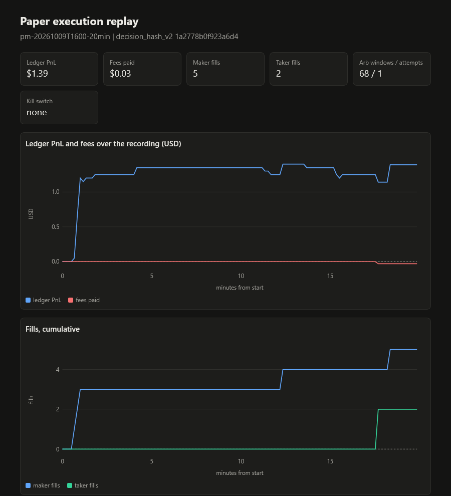
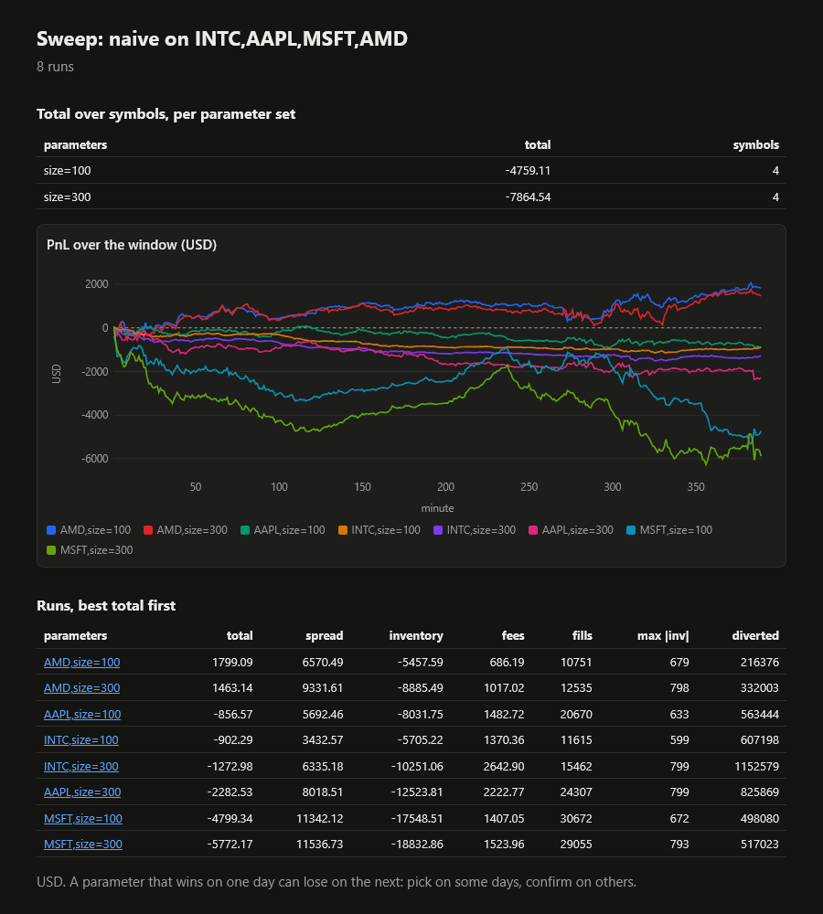

# hft

[](https://github.com/Yash-Awasthi/hft/actions/workflows/ci.yml)
[](https://github.com/Yash-Awasthi/hft/actions/workflows/image.yml)
[](https://codespaces.new/Yash-Awasthi/hft)

A low-latency market-data, surveillance and trading system in C++23, with no framework
underneath, in five parts:

- **Nasdaq TotalView-ITCH**, replayed from disk through an order-by-order book, a
  deterministic matching engine and an event-driven backtest.
- **A live prediction-market exchange** (Polymarket's public order-book stream), read by a
  hand-written TLS WebSocket client, recorded to disk, rebuilt into books and traded on paper
  by market makers and an arbitrage executor.
- **A paper execution layer**: pre-trade risk, an order manager, a ledger and a simulated venue
  with latency, queues, fees, settlement and injected faults. It never sends an order.
- **Microstructure research** on the same Nasdaq data, fitted on some days and tested on later
  ones: order flow imbalance, the micro-price, the value of queue position, and what a signal is
  worth to a market maker after latency ([results](#market-microstructure-research)).
- **Surveillance and execution quality** on real Nasdaq days: spoofing, layering and
  quote-stuffing candidates with their evidence ([surveillance](#market-surveillance)), a
  Rule 605-style best-execution report ([execution quality](#execution-quality)), and the book of
  any symbol at any moment of a day.

Your own strategies plug into both markets by name, and every run can write an HTML report.
[docs/APPLICATIONS.md](docs/APPLICATIONS.md) maps each part to the industry systems it mirrors.
[docs/METHODS.md](docs/METHODS.md) gives every model and estimator behind the results as a formula, with its source, code and test.

**Sample reports, generated by CI on every commit: [yash-awasthi.github.io/hft](https://yash-awasthi.github.io/hft/)**

| Paper execution on a recorded live session | One strategy on four Nasdaq symbols, two sizes |
|---|---|
| [](https://yash-awasthi.github.io/hft/paper/report.html) | [](docs/img/sweep-report.png) |

Contents: [Use it](#use-it) · [Plug in a strategy](#plug-in-a-strategy) · [Highlights](#highlights) ·
[Architecture](#architecture) · [Performance](#performance) · [Tests](#tests) ·
[Build and run](#build-and-run) · [Prediction markets](#prediction-markets) ·
[Live paper trading](#live-paper-trading) · [Paper execution](#paper-execution) ·
[Market microstructure research](#market-microstructure-research) · [Not planned](#not-planned)

## Use it

Two products behind one command, `hft` (`scripts/hft`; `bin/hft` in a release):

**1. Backtest on real Nasdaq order flow.** Fetch any day Nasdaq publishes, rebuild every order
book, and test a strategy against the real queues, with latency, fees and an HTML report:

```
hft get 2025-12-10                          # download (16 connections), verify, build the store
hft replay 2025-12-10                       # every book of the day, invariants checked: 847M messages
hft strategies                              # built in and your own (strategies/*.cpp)
hft backtest 2025-12-10 INTC,AAPL avellaneda_stoikov gamma=0.05     # -> report.html
hft study 2025-12-08,2025-12-09 2025-12-10  # imbalance, micro-price, queue value, Hawkes, VPIN...
hft leadlag 2025-12-10 QQQ:TQQQ,QQQ:SQQQ:-1  # who follows whom, against a placebo
```

**2. Paper-trade the live prediction market.** Market makers and an arbitrage executor run on
Polymarket's live order books through risk checks, an order manager and a simulated venue; no
order is ever sent. A dashboard on localhost shows latency, positions and PnL, with a kill switch:

```
hft live 30                                 # 30 minutes; open the dashboard URL it prints
hft runs                                    # past runs, PnL, killed or not
hft review 20261012T172311                  # replay a run bit for bit, write its report
```

`hft doctor` checks the tools, the data and the machine tuning; `hft demo` runs every demo on
bundled data. Without building anything, with Docker or Podman:

```
docker run --rm -v "$PWD/out:/hft/out" ghcr.io/yash-awasthi/hft
```

That writes HTML reports to `./out` (open `out/index.html`): strategies backtested on a synthetic
Nasdaq session, a parameter sweep, and paper execution replayed on a bundled 20-minute recording of
the live feed (`data/sample`), each checked against a fixed value.

From source (Linux, a C++23 compiler, CMake, Ninja, OpenSSL, vcpkg):

```
cmake --preset native && cmake --build build/native && ctest --test-dir build/native
export PATH="$PWD/scripts:$PATH"            # puts hft on the PATH
```

## Plug in a strategy

One type, one registration line, run by name ([docs/STRATEGIES.md](docs/STRATEGIES.md));
`scripts/new_strategy.sh NAME` writes a working starting point:

```cpp
// strategies/my_maker.cpp: Nasdaq backtester
struct MyMaker {
    void decide(const View& v, Desired& d) {         // book, inventory, own orders, features
        const auto b = v.book.bbo();
        if (b.bid_px && b.ask_px) d.bid_px = b.bid_px, d.bid_qty = 100, d.ask_px = b.ask_px, d.ask_qty = 100;
    }
};
HFT_STRATEGY("my_maker", "joins the best bid and ask", [](const Params&, const RunSpec&) { return MyMaker{}; });
```

```
itch_backtest <store> INTC my_maker --report out/mine                 # one run, report.html
itch_backtest <store> INTC my_maker --sweep size=100,200,500 --report out/sweep   # parallel sweep
itch_backtest <store> INTC,AAPL,MSFT my_maker --report out/multi            # several symbols
```

The prediction-market maker takes a quoter the same way (`strategies/pm/`, `HFT_QUOTER`), used by
`pm_exec --quoter NAME` on recordings or live on paper. The engine supplies latency, queue position,
fees, risk limits and accounting; the guide says what the simulation does and does not model.

## Highlights

Measured on a laptop (i7-13650HX, turbo off). Order book, live feed and research: bare-metal Arch
Linux with isolated cores; read/decode and paper execution: the earlier WSL2 setup. Sources in
the sections below.

- **Order book:** 41 ns per update at p50 on one symbol, worst case 40 µs; a full Nasdaq day
  of 12,000+ symbols rebuilt and hash-checked at 114-121M messages/s on 16 threads (847M
  messages in 7.0 s); read and decode at 31.6M messages/s.
- **Live feed:** own TLS WebSocket client and JSON parser (AVX2 structural scan); kernel receive
  to trading decision about 9 µs p50 with busy-polling threads on isolated cores.
- **Paper execution:** order intent to venue request 177 ns p50; 489k messages/s through books,
  makers, arbitrage executor, risk, order manager and simulated venue on one thread.
- **Determinism:** a live session replays from its recording to bit-identical decisions,
  checked by hash, under GCC and Clang; so do fault-injected runs and kill-switch runs.
- **Correctness:** zero heap allocations on the hot path in steady state; property tests against
  reference implementations; 332 tests, also run under ASan, UBSan and TSan; four fuzzers; fault
  campaigns at 20-30% dropped, duplicated and delayed reports with zero illegal order states.
- **FPGA feed parser (simulated):** ITCH 5.0 in SystemVerilog, 8 bytes per clock, one message
  per clock, output one clock after a message's last byte; field-identical to the C++ decoder in
  Verilator on a 375k-message synthetic day and 200k random frames.
- **Microstructure research, out of sample:** fitted on two Nasdaq days, tested on three later
  ones and one six months on. Order flow imbalance explains 55-66% of 10 s price changes on the
  December test days, and the depth law of Cont, Kukanov and Stoikov comes out at lambda = 1.01
  (paper: about 1); Stoikov's micro-price cuts next-mid prediction error by about 12%. An
  imbalance filter chosen on the train days cuts a market maker's loss by 66%; by June most of
  these edges have decayed, which the results show per day.
- **Honest results:** the obvious arbitrage loses money after fees and latency on recorded data
  (-67.45 USD over 61 attempts); reported as measured, with no thresholds tuned afterwards.

Peak, turbo on ([docs/results/max-performance.md](docs/results/max-performance.md), `scripts/bench_max.sh`).
"Under full load" runs one instance on every hardware thread at once:

| | One P-core | One E-core | P-core thread, full load | E-core, full load | Whole chip |
|---|---|---|---|---|---|
| Book update p50 / p99 (busiest symbol) | 20.4 / 66.2 ns | 32.5 / 113.0 ns | 36.6 / 159.9 ns | 43.0 / 272.3 ns | 399M updates/s |
| Prediction-market parse p50 / p99 | 297 / 1,781 ns | 480 / 2,725 ns | 618 / 3,845 ns | 586 / 3,389 ns | 8.6M msg/s |
| Prediction-market engine p50 / p99 | 100 / 287 ns | 169 / 476 ns | 229 / 2,114 ns | 203 / 1,697 ns | |
| Full Nasdaq day, 847M messages | 48.5 s, 17.5M msg/s | 65.6 s, 12.9M msg/s | | | 4.75 s, 178M msg/s (16 threads) |

Whole-chip figures are power and thermal limited and move about 10% between runs (138.8M to 183M msg/s
for the full day over five runs).

Where to read the code:

| What | File |
|---|---|
| L3 order book with two-level bitmap and radix tree | `src/book/tick_book.hpp` |
| Virtual orders inside the real queues | `src/engine/replay_exchange.hpp` |
| Lock-free single-producer single-consumer rings | `src/core/spsc.hpp` |
| SIMD JSON tape and single-pass message decoder | `src/net/tape.hpp`, `src/pm/msg.hpp` |
| ITCH parser in SystemVerilog and its Verilator check | `fpga/itch_parser.sv`, `fpga/itch_rtl_test.cpp` |
| Order manager state machine | `src/exec/oms.hpp` |
| Simulated venue with fault injection | `src/exec/sim_venue.hpp` |
| Arbitrage executor and leg-risk handling | `src/exec/arb_exec.hpp` |
| Strategy and quoter plug-ins | `src/backtest/registry.hpp`, `src/pm/quoter.hpp`, `strategies/` |
| Order flow imbalance and micro-price estimators | `src/strategy/microstructure.hpp`, `apps/itch_study.cpp` |
| Pools that grow by moving pages (mremap, huge pages kept) | `src/core/pool.hpp` |
| Design decisions and their reasons | `docs/exec/DECISIONS.md`, `docs/exec/DESIGN.md` |

Every number below names the command that produced it. Phases and what is not planned:
[docs/ROADMAP.md](docs/ROADMAP.md); state and verification: [STATUS.md](STATUS.md). Studies from
the earlier research phase (Python, signal and regime reports, transformer forecaster,
pre-registration) are kept at the [research-archive](https://github.com/Yash-Awasthi/hft/blob/research-archive/archive/) tag.

## Architecture

```
 ITCH day (.gz) --ingest--> per-symbol LZ4/zstd store + index + book checkpoints
                                  |
                   per-symbol replay on a thread pool / merged reader
                                  |
   L3 book per symbol (TickBook) <- ReplayExchange: virtual orders <- strategy
                                  |                                   (AS / GLFT, DP)
   MatchingEngine (price-time, IOC / post-only, STP, fees, half-penny tick)
                                  |
   Accounting (integer micro-dollars, PnL identity checked every event)

 Polymarket WS --TLS--> pm_record --> hourly zstd JSONL --> pm_stats / pm_mm

 pm_live:  feed thread per connection: TLS WebSocket -> kernel receive stamp -> SPSC byte ring
           trading thread: tape parse -> books -> makers (paper fills) -> risk -> arb scanner
           recording thread (replayable), HTTP thread: /metrics, /metrics.json, dashboard

 pm_exec:  same threads; makers and arbitrage executor -> pre-trade risk -> order manager
           -> simulated venue (latency, queue, fees, settlement, faults) -> ledger, kill switch
```

| Component | Where | Notes |
|---|---|---|
| ITCH decoder | `src/feed/itch.hpp` | Zero-copy, fuzzed (`fuzz/`) |
| Store | `src/data/store.*` | LZ4-HC or zstd chunks per symbol, global sequence numbers, sequence-window merge with N decompression threads |
| Book | `src/book/tick_book.hpp` | 2,048-tick window with a two-level bitmap, radix tree for deep levels, off-grid array; hot/cold order pools addressed by 32-bit index; open-addressing order-ID map |
| Matching engine | `src/engine/matching.hpp` | Price-time; property-tested against a naive reference |
| Replay exchange | `src/engine/replay_exchange.hpp` | Virtual orders in real queues; queue, trade-through and hidden-print fill rules |
| Backtest | `src/backtest/` | Event-driven; zero, random, foresight, naive, Avellaneda-Stoikov (GLFT), DP strategies |
| Network | `src/net/` | TLS socket (OpenSSL for the cipher layer only), HTTP/1.1 GET, WebSocket framing, SHA-1, base64; tape JSON parser with an AVX2 first stage; single-pass message decoder |
| Prediction markets | `src/pm/`, `apps/pm_*.cpp` | Recorder, typed message decoder, flat bitmap book, book rebuild, logit Avellaneda-Stoikov maker |
| Execution | `src/exec/` | Pre-trade risk and kill switch, order manager, ledger (integer units), simulated venue, arbitrage executor |
| Core | `src/core/` | Index-addressed pools, SPSC ring, log-linear histogram, `rdtscp` timing, Philox RNG |

Every piece of engine state lives in index-addressed pools, so a book or engine fork is a
copy of the used part of each pool with no pointer fix-up. Replay is single-threaded and
deterministic per symbol; zstd/LZ4 chunks are decompressed ahead of it and handed over in
sequence order, so the merged stream stays byte-identical to the download.

Third-party code at run time: zstd, LZ4 and zlib-ng for storage, OpenSSL for TLS.
GoogleTest, RapidCheck and Google Benchmark are used by tests and benchmarks only.

## Performance

Measured on an i7-13650HX under WSL2, pinned, mains power, turbo off (about 2.4 GHz, clock
read before and after every run), 10 repetitions after one warm-up, medians with 95%
bootstrap intervals; before/after differences tested with Mann-Whitney. Cycle figures are
given where the reports derive them.

Targets were revised once, after the baseline and one optimisation pass. The original
targets were set from runs with turbo on (about 4.7 GHz); the baseline fixes the clock at
about 2.4 GHz so before/after comparisons are stable, which roughly doubles every time figure
for the same cycles. Old and new targets with the reason for each are in the revision record,
[DESIGN.md section 9](https://github.com/Yash-Awasthi/hft/blob/research-archive/archive/docs/DESIGN.md#target-revisions) (research-archive tag).

| Path | Target | Baseline | Now | Cycles (now) | Source |
|---|---|---|---|---|---|
| Book update, one symbol (GOOGL), p50 | ≤ 55 ns | 53.5 ns | 52.8 ns | 127 | [ms2](docs/results/ms2-book-study.md) |
| Book update, one symbol (GOOGL), p99 | ≤ 160 ns | 152 ns | 136 to 159 ns | 336 (at 139.8 ns) | [ms2](docs/results/ms2-book-study.md) |
| Book update, 50 symbols interleaved, p50 / p99 | reported, no target | 81.0 / 366 ns | 79.6 / 367 ns | | [ms2](docs/results/ms2-book-study.md) |
| Read + decode, 50 symbols | ≥ 30M msg/s | 17.8M | 31.6M (two decompression threads) | 74 per message, decode thread alone (32.3M) | [ms2](docs/results/ms2-book-study.md) |
| Full-day replay, 50 stocks, one replay thread | ≤ 60 s | 25.9 s | 23.9 s | | [ms2](docs/results/ms2-book-study.md) |
| Fork, 10k orders | ≤ 100 µs, ≥ 10 GB/s | 53.4 µs, 16.0 GiB/s | 46.9 µs, 17.2 GiB/s (one book; 50 books 4.95 ms by copy, 1.40 ms by process `fork()`) | | [ms2](docs/results/ms2-book-study.md) |

The single-symbol p99 moves between runs (152 ns at the baseline, 175 ns in one later run),
so it is given as the 95% interval after the optimisation pass; the median is stable.

What moved the numbers:

- **Merge.** Records from all symbols are scattered into a 4,096-sequence window and emitted
  by a bitmap scan instead of one heap operation per record: the decode thread went from
  23.8M to 32.3M msg/s.
- **Read-ahead.** Chunks decompress on N threads and are handed over strictly in sequence
  order, so output stays byte-identical (store SHA-256 unchanged): the pipeline went from
  18.1M to 31.6M msg/s with two threads.
- **Book.** One order-ID probe per operation instead of two to four, keeping the hash table
  image identical so stored checkpoints still verify: 7.5% off the single-symbol batch cost.

A later pass (replay lookahead, backtest hot paths, LZ4 store, per-symbol replay) was timed
back to back against the previous `main`, so these pairs are comparable with each other but not with the table above, whose clock drifted between sessions:

| Path | Before | After |
|---|---|---|
| Full-day replay, 50 stocks, 147.6M events | 24.1 s | 17.2 s |
| `book_replay`, all 12,076 symbols | 40.8 s | 7.5 s |
| `checkpoint` write / verify | 4.7 s / 2.4 s | 0.92 s / 0.66 s |

The merged-feed replay lookahead is used only by `bench/book_study.cpp`; the production
replays are per symbol.

Profile-guided build (`pgo-gen`, run `book_study replay` and `replay-sym`, then `pgo-use`): per-symbol
replay of the 50 busiest symbols 11.7 s to 10.6 s (-10%, two runs each, one thread); the merged
replay is unchanged within noise. A lookahead prefetch on the per-symbol path was slower
(10.5 s to 11.7 s) and was dropped.

## Tests

`ctest` runs 332 tests: GoogleTest, RapidCheck and end-to-end runs of `hft`, `itch_study` and `itch_leadlag` (328 under the sanitizers, which leave out
`alloc_test`); one (`PerfCounters.CountsInstructionsWhenAvailable`) skips where the machine
exposes no hardware performance counters.

- A synthetic fixture is regenerated byte for byte; its golden BBO and matching-engine hashes
  are equal under GCC 13 / 15 and Clang 18 / 21.
- Decoder fields are identical to the third-party itchfeed parser on 12M messages; the merged
  store stream is byte-identical to the decompressed download (SHA-256).
- The tick book gives the same BBO stream as `std::map` on full days (353M and 650M messages).
- Invariants are checked on every event of 255M book events; there are zero heap allocations in
  steady state (`alloc_test`); checkpoints replay to byte-identical state.
- The matching engine is checked against a naive reference engine (RapidCheck).
- The SystemVerilog ITCH parser is compared field by field with `hft::itch::dispatch` on every
  frame, with random beat sizes and at full rate, including malformed lengths and unknown types:
  `cmake -S fpga -B build/fpga && cmake --build build/fpga && build/fpga/itch_rtl_test [file]`
  (needs Verilator 5). Shifting one field offset makes it fail.
- WebSocket framing, SHA-1, base64 and JSON have known-answer tests.
- The order manager, ledger, risk checks, simulated venue and arbitrage executor have unit tests,
  each checked by mutating the code it covers (counts in docs/exec/PHASES.md).

CI (`.github/workflows/ci.yml`) builds and tests GCC and Clang across the `debug`,
`release`, `asan`, `ubsan` and `tsan` presets, runs the benchmarks once as a smoke test,
checks that every app refuses bad arguments (`scripts/check_cli.sh`), runs the security gates
(`scripts/security_gates.sh`: no order entry code, no secrets, no shell-outs) and fuzzes the
ITCH decoder, the JSON tape, the order manager and WebSocket framing for 60 s each, and
lints and simulates the FPGA parser.

Checks on the recordings, run by hand: `scripts/check_parity.sh` (maker fills identical through
the order manager and venue in compatibility mode), `scripts/fault_campaign.sh` and
`scripts/arb_fault_campaign.sh` (faults at 20-30%), `scripts/demo/*.sh` (fixed hashes).

## Build and run

Requires CMake, Ninja, a C++23 compiler, OpenSSL development files and `VCPKG_ROOT` pointing
at a vcpkg checkout.

```
cmake --preset release
cmake --build build/release
ctest --test-dir build/release
```

Presets: `debug`, `release`, `native` (this CPU, LTO), `asan`, `ubsan`, `tsan`, `fuzz`, `pgo-gen`, `pgo-use`.
`scripts/pgo.sh <store> [pm-record-dir]` runs the profile-guided build end to end.

Ingest one ITCH day into a per-symbol store (download, verify, ingest):

```
scripts/ingest_day.sh S121225-v50.txt.gz
store_cat <store> [threads] | sha256sum          # merged stream, equals the download
book_replay <store> tick                         # BBO hash and invariants, every symbol (THREADS=N)
checkpoint <store> [--verify]                    # write or verify book checkpoints
book_study <store> book 50 10                    # book update latency, 50 busiest symbols
book_study <store> replay-sym 50 10 [threads]    # full-day replay, one symbol at a time on a pool
itch_backtest <store> INTC avellaneda_stoikov maker_rebate=2000 taker_fee=3000 max_dist_ticks=5
itch_study --train <store>,<store> --test <store>,.. [--symbols N]   # OFI, micro-price, queue position
```

Downloads go through `aria2c` with 16 connections when it is installed: the server throttles each
connection to about 220 KB/s.

`itch_backtest` runs one strategy on one symbol-day: the strategy sees the market a
market-data latency late, its orders join the real queues after the order-entry latency,
fees and risk limits apply, and the PnL identity is checked on every event. Strategies:
`zero`, `naive`, `imbalance`, `random_taker`, `random_passive`, `perfect_foresight`,
`avellaneda_stoikov`, `dp:<policy>`, `ext:<policy>`. INTC on 2025-12-10 (1.8M events)
runs in about 1.5 s.

`ingest <store-dir> <day.gz> [--codec lz4|zstd]` checks the gzip CRC and records the SHA-256
of the download. LZ4-HC decompresses 3.5 times faster than zstd for 11% more disk;
`transcode <src> <dst> [--codec lz4|zstd]` rewrites a store in the other codec, keeping chunk
boundaries so checkpoints stay valid.

Smaller tools: `zcat day.gz | itch_count` counts messages per type; `itch_dump` prints one
canonical line per message (used for the field-by-field comparison with itchfeed);
`gen_fixture <seed> <symbols> <messages> <out.zst>` writes a synthetic ITCH day.

## Prediction markets

`pm_record` stores the public order-book stream: one line per message with the receive time,
in hourly zstd files. It picks the markets with the most volume per tag, reconnects with
backoff, logs every gap and stops at a size cap. `scripts/pm_supervise.sh <dir>` restarts it
after a crash; `status.json` in the record directory holds message counts, reconnects and the
age of the last message per connection.

```
pm_record --out data/pm --cap-gb 50 --per-tag 8
pm_stats data/pm > tokens.tsv     # per-token book rebuild: spread, depth, trades, consistency
pm_mm data/pm > mm.tsv            # logit Avellaneda-Stoikov maker on the recorded books
```

Both tools read a recording at about 1M messages per second: zstd decompression runs on a second
thread, a single-pass message decoder (falling back to the tape JSON parser for anything outside
the shapes the exchange sends) produces typed events, and each token's book
is a flat price array with a two-level bitmap (on 2.0M messages, `pm_stats` went from 11.0 s and
469 MB to 1.9 s and 31 MB with identical output).

`pm_stats` checks its rebuilt book against the exchange's own best prices (0.03% of deltas
differ in a 20-minute sample). `pm_mm` fills quotes from recorded trades only, with a
queue-ahead count per order, so its fills are conservative.

## Live paper trading

`pm_live` runs the whole pipeline on the live stream and never sends an order:

```
pm_live --record data/live --seconds 3600          # dashboard on http://127.0.0.1:8088/
pm_live --record data/live --spin --cpu 4          # busy-poll a pinned core for latency
pm_live --record data/live --spin --spin-feeds     # feed threads busy-poll too: one core per connection
pm_live --replay data/live                         # same decisions, same hash
scripts/pm_live_supervise.sh data/pm-live --seconds 21600   # restart every 6 h, one directory per run
```

`pm_arb <dir>` replays one run, or every run under a directory, through the books and the
scanner alone and lists each arbitrage window (group, side, duration, edge, size on the
thinnest leg), with per-group totals on stderr.

Recordings rotate hourly (zstd) and stop at `--record-cap-gb` (default 20) while trading
goes on. A stop signal exits with 128 plus the signal, which the supervisor treats as a stop.

It picks the most traded events in which exactly one market resolves Yes and every open
market trades, and subscribes to every token in them. Each connection has its own thread,
which takes each message's receive time from the kernel (`SO_TIMESTAMPNS`) and copies the
message, decrypted in place, once into a lock-free byte ring. The trading
thread drains the rings and passes each message through the tape parser and the books. A logit
Avellaneda-Stoikov maker runs per token, with paper fills from live trades behind a
queue-ahead count. Portfolio risk can halt the session on a loss stop, and pauses quoting
when gross inventory hits its cap or a connection goes silent. On a reconnect, books stay
invalid until a fresh snapshot arrives. The arbitrage scanner tracks every window in which
an event's Yes asks sum below 1 or its bids above 1, and does the same for each market's
Yes/No pair.

The trading core is a pure function of the (receive time, message) sequence. The recording
holds exactly that sequence in processing order, including heartbeats and the trading
thread's own clock records, so `--replay` reproduces the live decisions bit for bit (checked
by a hash of the decision log). `/metrics` is Prometheus text; `/metrics.json` feeds the
dashboard.

Latency on this laptop (WSL2, one 60 s session each, per message, from the feed thread's
stamp to decision; measured before the kernel timestamps below):

| Mode | Ring queue p50 | Parse p50 | Books, strategy, risk p50 | Wire to decision p50 / p99 |
|---|---|---|---|---|
| default (futex doorbell) | 135 µs | 8.5 µs | 6.6 µs | 151 / 916 µs |
| `--spin --cpu 4` | 2.2 µs | 2.4 µs | 1.0 µs | 9.8 / 210 µs |

Under WSL2, waking an idle virtual CPU goes through the hypervisor, so the futex wake is
slow; the default trades latency for an idle core. Ring queueing in spin mode comes from
bursts: messages arrive back to back faster than they are processed.

With the kernel's receive time, the wait before the feed thread runs is counted too (60 s
live paper runs, docs/exec/PERF.md R8 and R9): kernel to ring 173 µs p50 with sleeping feed
threads and 31 µs with `--spin-feeds`; with `--spin --spin-feeds`, wire to decision is about
39 µs p50, against about 280 µs with every thread sleeping. Spinning costs one busy core per
connection plus one for the trading thread, so it is off by default on the laptop.

On bare metal with the trading thread on an isolated core (docs/exec/PERF.md R16), wire to
decision is about 9 µs p50 spinning (kernel to ring 6.8 µs, ring to decision 2.1 µs) and about
190 µs with every thread sleeping. `--feed-cpus 6,7` pins the feed threads.

Live figures move with the market and the network, so the trading thread is tuned on a
fixed recording instead: `pm_live --replay` times parse and engine for every message. On a
5-hour run (2.0M messages, `native` build, pinned to two cores), against the code before the
pass:

| Change | Parse p50 / p99 / p99.9 | Engine p50 / p99 | Replay wall time |
|---|---|---|---|
| before | 975 / 3,424 / 15,707 ns | 240 / 740 ns | 2.43 s |
| single-pass decoder (tape fallback on 1.4% of messages) | 545 / 3,122 / 8,379 ns | 232 / 633 ns | |
| best price kept per book side, one token lookup per snapshot | | 176 / 525 ns | 1.92 s |

The decision hash and `pm_stats` output are unchanged (`pm_stats` on 278 MB of recordings:
4.17 s to 3.31 s). The decoder's single pass is checked against the tape by a property test
and by the fuzzer. Metrics no longer render on the trading thread: once a second it swaps a
snapshot and its window of histograms under a lock it only tries, and the HTTP thread does
the rest (stall 376 µs to 24 µs at p50, 718 µs to 76 µs at worst, over 60 s live).

## Paper execution

`pm_exec` puts the makers and an arbitrage executor behind pre-trade risk, an order manager
and a simulated venue (latency, queue position, fees, settlement, faults). Nothing leaves the
machine: there is no order entry code. Design and decisions: [docs/exec](docs/exec/INDEX.md).

```
pm_exec --replay data/live --config config/exec.cfg --set arb=1   # summary and hashes
pm_exec --paper --run runs/today --config config/exec.cfg          # live feed, recorded
pm_exec --replay runs/today                                        # the paper run's own hashes
touch runs/today/KILL                                              # or SIGUSR1: cancel all, stop
```

- A run is a function of the recording, `exec.cfg` and its seed: replays give the same
  `decision_hash_v2`, and a paper run replays to its own hashes, kill switch included.
- Dropped acks and fills, duplicates, disconnects and failed settlements at 20-30%: zero
  illegal reports; a dropped fill ends in the kill switch naming the position mismatch; no
  arbitrage set is left incomplete without being counted.
- On the 2.0M-message reference recording, pinned to one vCPU: intent to venue request
  177 ns p50 / 712 ns p99, engine 555 ns p50 per message, 489k messages/s; in isolation the
  risk check takes 25 ns and each order-manager operation 16 ns (`hft_bench`).
- Six recordings (6.6M messages) at the measured 182 ms round trip: 1,041 arbitrage windows,
  most on stale books or below fees; 61 attempts, of which 2 completed as planned, 5 filled
  nothing, 52 lost a leg and were completed at a loss, 1 was unwound and 1 has no counted
  outcome (no residual set): -67.45 USD realised after fees. The cheap leg
  of a near-resolved pair has usually moved by the time the order arrives.
- Full tables and their commands: [docs/exec/RESULTS.md](docs/exec/RESULTS.md); demos with
  fixed hashes: `scripts/demo/`.

## Market microstructure research

Published results checked on this repository's own L3 data, with every parameter fitted on
2025-12-08 and 12-09 and scored unchanged on 12-10, 12-11, 12-12 and 2026-06-12 (30 most active
symbols, 10:00 to 15:30 ET). The June day, six months after training, shows how fast the fits
age. One command each, about 30 s and 15 minutes on 16 threads:

```
scripts/study.sh > docs/results/microstructure.md          # itch_study: OFI, micro-price, queue
scripts/maker_walkforward.sh > docs/results/maker-walkforward.md
scripts/results.sh                                          # every results page, then git diff
```

- **Order flow imbalance** ([Cont, Kukanov and Stoikov 2014](https://arxiv.org/abs/1011.6402)):
  price changes over 10 s are linear in the order flow at the best quotes. The slope falls with
  depth as 1 / depth^lambda with lambda = 1.01 (log-fit R2 0.94 over 660 half-hour windows; the
  paper reports about 1). Median R2 0.72 in sample; on the December test days 0.55-0.66 with each
  stock's own slope and 0.60-0.63 with the single two-parameter law. Six months later the own
  slopes drop to 0.26 while the depth law keeps 0.47: depth moved, the relation did not.
- **Micro-price** ([Stoikov 2018](https://doi.org/10.1080/14697688.2018.1489139)): a Markov chain
  on (imbalance, spread) states, estimated from symmetrised train transitions, gives the expected
  future mid. It cuts the squared error against the next mid change by a median 11.6-12.5% on
  each December test day and 3.4% in June (21 large-tick symbols); the size-weighted mid is
  worse than the plain mid on 12 of the 21 symbols over the test days. The fitted adjustment runs
  from -0.39 to +0.39 ticks.
- **Queue position** (Moallemi and Yuan 2017): 53.6M orders joining the best quote at a 1-tick
  spread, tracked by reference to their first fill. Front of the queue (under a quarter of a
  typical level ahead) fills 7.0% of the time after 1.3 s on average, with a 1 s markout of -0.25
  ticks; one to two levels back, 3.5% after 3.7 s at -0.37 ticks. Position is worth fill rate and
  less adverse selection at once, and every bucket still loses before rebates.
- **Order lifetimes** (Hasbrouck and Saar 2009): every order on the 30 symbols followed by
  reference. 86-92% of orders added in December 2025 were cancelled within 2 s (93.6% in June
  2026), a quarter of them within 1 ms; on 2019-10-18 the share was 70.4% (13.2% within 1 ms),
  against about a third in the paper's 2004 sample. Only 1.3-2.8% of orders ever execute.
- **Trade costs** (SEC Rule 605 style): every visible execution signed by its taker. Takers pay an
  effective half-spread of 0.54-0.62 bp on the December days (1.11 bp in June 2026, 0.84 bp in
  2019), but within 5 s the mid moves 0.85-1.71 bp their way, so the resting side's realized
  spread is negative on every day (-0.32 to -0.59 bp) and worse for bigger executions (-1.39 bp
  above 2,000 shares): before rebates, passive liquidity on these names loses money.
- **Intraday pattern**: per half-hour, activity falls from about 700 mid changes a minute at 10:00 to
  under 300 at midday, spreads narrow (1.71 to 1.42 ticks) and depth grows through the day, while
  the Hawkes branching ratio stays at 0.51-0.52 in every window, so the self-excitation above is not
  intraday seasonality.
- **VPIN** (Easley, Lopez de Prado and O'Hara 2012) on exact trade signs, 500 volume buckets per
  symbol-day: its correlation with the next bucket's absolute return is -0.07 to +0.04 on every day,
  the same as with the current bucket's, so on these names it carries no volatility signal (as
  Andersen and Bondarenko 2014 argue). Average VPIN fell from 0.56 in 2019 to 0.31-0.36 in 2025-26.
- **Volatility signature**: realized variance of the mid sampled every 1-60 s against every 300 s.
  The median ratio stays between 0.82 and 1.44 on every day (0.89-0.98 in 2019): on the mid, which
  has no bid-ask bounce, microstructure noise does not dominate even at 1 s for these names.
- **Self-excitation** (Hawkes, after Filimonov and Sornette 2012): an exponential Hawkes process fitted
  by maximum likelihood (checked on simulated processes) to each symbol's mid changes per half-hour.
  The branching ratio, the share of changes triggered by earlier ones, is 0.50-0.53 on every 2025-26
  day and 0.46 in 2019, with a memory of 0.3-0.7 ms: about half of all price changes are fast
  reactions to earlier ones. An exponential kernel sees only this fast part; studies with long-memory
  kernels put the ratio near 1.
- **Does it pay?** Joining the best bid and ask on 10 large-tick symbols loses on every one of
  them (adverse selection outweighs the spread). Pulling the side the imbalance points against,
  with the threshold chosen on the train days, loses 66% less over the four test days (-$40.1k
  against -$117.2k without fees; -$27.8k against -$67.1k with a $0.002 rebate), better on 9 of 10
  symbols and profitable on two; still a net loss, reported as measured. The edge is in December
  (-$4.7k to -$15.4k against -$31.4k to -$37.0k per day) and gone by June (-$13.8k against
  -$14.1k). It also decays with latency: -$40.1k at zero, -$44.4k at 5 and 50 µs, -$47.9k at
  500 µs and -$54.1k at 5 ms one way.

- **Lead-lag** (`scripts/leadlag.sh`, 15 pairs, five December days): after a mid move of one
  product, the next move of a related one goes the same way 59-74% of the time, against 50.0% when
  the leader's moves are shifted 2 s (a placebo that keeps slow common drift). The edge runs both
  ways and is largest from the less active side (SOXL to SOXX +23 points, UPRO to SPY +19, GOOG to
  GOOGL +17). 91-99% of the following moves arrive more than 10 µs later, slower than this
  system's measured 9 µs from wire to decision; most take 0.1 ms to 1 s.
- **Trading on it** (`scripts/leader_walkforward.sh`): the imbalance maker on 12 follower products
  also steps back from the side its leader's 0.1 s momentum points against (threshold chosen on the
  train days: any adverse leader move). On the four test days it loses less on held inventory
  (+$26.3k, 95% interval [+$7.6k, +$49.7k] over 48 follower-days) but gives up spread (-$13.7k,
  [-$20.2k, -$8.6k]); the net +$12.6k ([-$5.2k, +$33.7k]) is not significant, better on 24 of 48.
  The imbalance filter alone, by contrast, is: +$77.1k ([+$33.7k, +$108.4k]) over the plain joiner,
  better on 38 of 40 symbol-days without fees, and +$57.9k ([+$13.3k, +$92.6k]) with the $0.0007
  rebate; with the $0.002 rebate, which pays the joiner for its extra fills, +$39.2k is not
  significant ([-$2.4k, +$69.5k]).

Six years back, the same train fit scored on 2019-10-18 (`TEST=S101819`, symbols that existed
then): each stock's own OFI slope no longer transfers (median R2 0.10) while the depth law still
scores 0.59; the micro-price still cuts next-mid error by 8.1%; and the imbalance-filtered maker
makes money that day (+$1.3k against -$6.7k for the joiner without fees, +$1.3k against -$6.1k
with the rebate and 2019's Section 31 and TAF rates; paired over the 9 symbols +$8.0k, 95% interval
[+$2.6k, +$13.7k]) until one-way latency reaches 50 µs. One
day, so a check of direction, not of size: [microstructure-2019](docs/results/microstructure-2019.md),
[maker-walkforward-2019](docs/results/maker-walkforward-2019.md).

Full tables: [docs/results/microstructure.md](docs/results/microstructure.md),
[docs/results/maker-walkforward.md](docs/results/maker-walkforward.md),
[docs/results/lead-lag.md](docs/results/lead-lag.md),
[docs/results/leader-walkforward.md](docs/results/leader-walkforward.md). The estimators are in
`src/strategy/microstructure.hpp`, unit-tested against the papers' cases and a chain with a known
answer (`tests/microstructure_test.cpp`).

## Market surveillance

`itch_surveil` (or `hft surveil DAY`) scans every symbol of a stored day for the patterns exchange and
broker surveillance desks review, and lists each candidate with its evidence:

- **Spoofing:** an order at the best price, at least 10x the usual depth and 5,000 shares, cancelled
  unfilled within 2 s while at least 1,000 shares traded on the other side.
- **Layering:** one participant's (attributed MPID) burst of orders over several price levels near
  the best, cancelled unfilled together.
- **Quote stuffing:** a 100 ms burst of 50x the symbol's usual message rate, mostly cancels, almost no
  executions.

On the eight stored days it flags 6-68 spoofing, 14-128 layering and 3-409 stuffing candidates per day
out of 8,900-12,800 symbols ([docs/results/surveillance.md](docs/results/surveillance.md), with the
full report for 2025-12-10). The public feed is anonymous apart from MPIDs, so these are leads for a
reviewer, not findings; the detectors are unit-tested on injected patterns and near misses
(`tests/surveil_test.cpp`). `hft book DAY SYMBOL HH:MM:SS` shows the book at any moment of a flagged
incident, from the nearest stored checkpoint.

## Execution quality

`itch_bestex` (or `hft bestex DAY`) is a best-execution report in the spirit of SEC Rule 605, the
statistics brokers publish about how their customers' orders were filled: per symbol and per
execution size, the effective half-spread split into realized spread and 5 s price impact, and the
share of volume executed inside the quote against hidden orders with its price improvement. For the
25 most active symbols of 2025-12-10 ([docs/results/execution-quality.md](docs/results/execution-quality.md)):
takers paid 0.4-3.3 cents a share over the mid; for most symbols the mid then moved further their
way, so the realized spread is negative (down to -0.67 cents, up to +0.29), and it falls with size
(-0.21 cents up to 100 shares, -1.36 above 2,000); 2-33% of shares executed inside the quote, about a
cent better than the displayed price. Unit-tested on hand-computed fills (`tests/bestex_test.cpp`).

## Not planned

- Live order entry: never. There is no order entry code, and a CI gate keeps it that way.
- A dedicated or cloud machine for hardware counters and spin-mode numbers on isolated cores:
  not available here; the numbers are from a laptop under WSL2.
- A miss-probability model for the arbitrage executor: a research step, outside this project.

## License

MIT; see [LICENSE](LICENSE).
